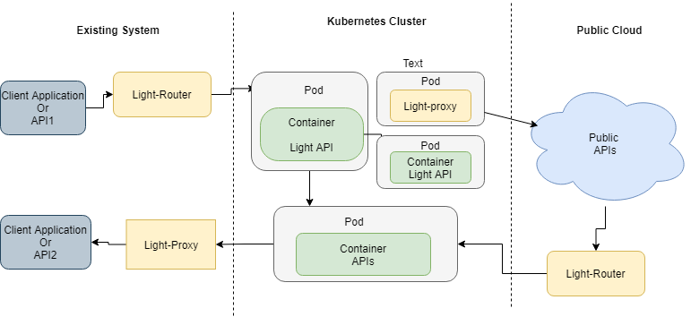

## light-gateway:

A standalone gateway combined light-proxy and light-router to address cross-cutting concerns for incoming and outgoing requests. Compared with the [http-sidecar](https://github.com/networknt/http-sidecar), which has the same light-proxy and light-router features, the light-gateway is more flexible for deployment. It can be deployed in a container, a Windows service or a Linux service. There might be multiple clients and services for light-gateway to support many-to-many communication. However, the http-sidecar is designed to deploy in the same Kubernetes pod with the backend API to form a one-to-one relationship. In other words, the http-sidecar is a stripped-down version of the light-gateway.

### Deployment Pattern

There are 6 patterns to deploy the light-gateway and the only difference is the configuration. The same jar file or docker image can be used for different use cases.

* External Gateway

The external gateway is deployed in the DMZ to help the third-party clients access APIs in the DMZ or corporate network. It is a shared gateway for multiple clients to access a limited number of APIs inside. Compared with the internal gateway, it has more security handlers configured. For example, an IP whitelist handler will allow certain IP addresses to access the gateway, or a rate-limiting handler is set up to prevent DDoS attacks, etc.

Verifying the JWT tokens is a very common practice on the external gateway to ensure only the valid requests will be passed through the firewall and sent to the internal gateway.

* Internal Gateway

The internal gateway is another shared gateway deployed inside the corporate network to help legacy clients to communicate with legacy services. The configuration should be very similar to the external gateway but remove some middleware handlers. For example, JWT token signature verification might not be enabled on the internal gateway.

* Client Router

In this pattern, only the router feature of the light-gateway is used to bring the legacy client to the light ecosystem. The instance is dedicated to a particular client application like a monolithic web server and deployed on the same host.

The gateway is responsible for getting the JWT token on behalf of the client, caching it, and renewing it before expiration. Also, the gateway will route all the API accesses so that the client will only deal with one API regardless of how many are behind the gateway.

* Service Proxy

In this pattern, only the reverse proxy feature of the light-gateway is used to bring the legacy service to the light ecosystem. The instance is dedicated to a particular service that exposes some API endpoints.

The gateway is responsible for verifying the JWT token, validating the incoming requests, and all other cross-cutting concerns. Then the request will be forwarded to one or many backend instances. With the light-gateway deployed on the same server, you don't need to update anything on the legacy server.


* Service Gateway

This pattern is similar to the service proxy but has the router feature enabled simultaneously. It is for legacy a service that accepts incoming requests and calls other APIs.


* Backend as Frontend

This is for a big application that will access a lot of backend microservices. The light-gateway will aggregate all the backend API together so that the client application can deal with only one API instead of hundreds. For example, a mobile banking application needs to access a lot of microservices for its functionalities.

* SPA Server

This is a similar pattern like the Backend as Frontend with added feature to serve the single page application on the same server without cors enabled.


    light-gateway can be deployed as API gateway to handle restful request/response related functionalities which include:

     - Package and deployed as separate module to handle Cross-Cutting Concerns for main container/service in the same pod. In this case, the main service only need care about the http request/response and business logic

     - Ingress traffic: client  request(legacy) will come to light-gateway first, light-gateway act as a proxy to delegate light client features, which include, openapi schema validation, observability, monitoring, logging, JWT verify, etc. Then forward the request to main service.

     - Egress traffic: main service call through light-gateway for egress traffic; in this case, light-gateway act as a router to delegate light client features, which include service discovery, SSL handshake, JWT token management, etc. Then forward the request to server API.


### Architecture diagram


- Se light-gateway deployment :



By default, the light-gateway works as internet gateway for both proxy/router features. Most of middleware handlers are commented out. User can enable it  based on different user cases.

Please refer to default setting for detail:

 [handler](https://github.com/networknt/light-gateway/blob/master/src/main/resources/config/handler.yml)
 [values](https://github.com/networknt/light-gateway/blob/master/src/main/resources/config/values.yml)

### Light-gateway features and config setting:

- Proxy

  Light-gateway Proxy used for dispatch the request from light-4j API to existing system (legacy). Since existing system may not have some microservice features, for example:

  - Audit log
  - JWT verify
  - Metrics
  - Openapi schema validation

  Light-gateway proxy can handle those features and forward the request to  existing system.

  The major config for proxy is "proxy.host", user can define a list of proxy destination host separate by ",'. For example

  proxy.host: https://localhost:9443,http://localhost:8080,https://www.networknt.com

- Router

  Light-gateway Router used for dispatch the request from existing system to light-4j restful API. Normally the existing system doesn't support some microservice feature for service call:

  - Service discovery
  - Audit log
  - JWT populate
  - Metrics

  Light-gateway Router can handle those features and forward the request to new microservice API.

  Light-gateway Router be triggered if the request header include key "service_id" or "service_url" (if both existing, service_url will be taken first)

  The major config for the router includes:

  serviceDict.mapping:
  router.hostWhitelist:


### Note:

If you want to use SidecarServiceDictHandler to get the service Id by the path url mapping from serviceDict.yml, add it before token handlers and router handler. The service Id get from serviceDict
will be used for next handler chain.

```
  - com.networknt.router.middleware.GatewayServiceDictHandler@path
  - com.networknt.router.middleware.GatewaySAMLTokenHandler@saml
  - com.networknt.router.RouterHandler@router

```


### start light-gateway locally and verify:

- start light-gateway service

```
cd ~/workspace
git clone git@github.com:networknt/light-gateway.git

cd light-gateway

mvn clean install


java -jar -Dlight-4j-config-dir=config/local  target/light-gateway.jar


```

The light-gateway service will start on http port 9080 and https port 9445.

The service API could use any technology. The light-gateway service will handle the ingress and egress traffic to the pod and leverage light-4j cross-cutting concerns and client module features.


- Start or configure a backend service

The local configuration profile proxies ingress traffic to `http://localhost:8080`.
Run your backend service on that port, or update `proxy.host` in `config/local/values.yml`
to point to the service you want to place behind the gateway.


- Start a sample light-4j API from light-example-4j (It is simulate the outside service which service in the Pod need to call):


```
 cd ~/networknt
 git clone git@github.com:networknt/light-example-4j.git
 cd ~/networknt/light-example-4j/servicemesher/services

 mvn clean install -Prelease

cd petstore-service-api

java -jar target/petstore-service-api-3.0.1.jar

```

The petstore light-api will start on local https 8443 port.


- Try the call by using light-gateway:

#### Egress traffic (http protocol, port 9080)

Send request from service in the pod to light API petstore through light-gateway

```
curl --location --request GET 'http://localhost:9080/v1/pets' \
--header 'Content-Type: application/json' \
--data-raw '{"accountId":1,"transactioType":"DEPOSIT","amount":20}'
```

#### Ingress traffic (https protocol, port 9445)

Send request from outside service to the service in the pod through light-gateway

```
curl --location --request GET 'https://localhost:9445/api/books/' \
--header 'Content-Type: application/json' \
--data-raw '{"name":"mybook"}'
```

Leverage schema validation handler cross-cutting concerns

```
curl --location --request POST 'https://localhost:9445/api/books/' \
--header 'Content-Type: application/json' \
--data-raw '{"author":"Steve Jobs"}'
```

response:

```
{
    "statusCode": 400,
    "code": "ERR11004",
    "message": "VALIDATOR_SCHEMA",
    "description": "Schema Validation Error - requestBody.title: is missing but it is required",
    "severity": "ERROR"
}
```
#### Compile to native executable with Graalvm native-image

Graalvm and its native-image are required to compile uber jar file native executable, please following the [link](https://www.graalvm.org/java/quickstart) to install latest version of Graalvm

```
  mvn clean install

  native-image -jar target/light-gateway.jar -o target/application
```
you can execute the generated executable with following command:

```
  target/application -Dight-4j-config-dir=config/local
```

## Jackson 3 source line

This line requires the Jackson 3 framework and yaml-rule-plugin sources, Jackson 3.2.3, json-schema-validator 3.0.8 and yaml-rule 4.0.0-SNAPSHOT. Build the migrated prerequisites first; old snapshot binaries can expose incompatible Config mapper descriptors. Annotations retain com.fasterxml.jackson.annotation; the framework preserves measured Jackson 2 mapper defaults. Classic SnakeYAML cleanup is deferred.

Final distribution qualification requires the pinned, merged chaos-monkey cleanup and a fresh dependency/build check. Local tests and mapper parity do not imply deployed integration or remote CI qualification.

### Reproducible Jackson 3 source build

`.github/workflows/jackson3-source-build.yml` builds the prerequisite source stack in an isolated Maven repository, reuses independently qualified full-core test evidence, and runs the prerequisite and full consumer suites. It pins reviewed policy `f0d2100f972eec765b2b276e7ace38922394f0a6` and candidate `97b2359b92ed3e1d05cac04f2da8760aa954e49d`; yaml-rule/http-client are selected from that verified evidence. The complete prerequisite closure is pinned in `ci/jackson3-source-refs.json`, initialized from the successful source-build manifest, with reviewed updates expressed as full SHAs; no default-branch or migration-branch lookup is used. Explicit `source_refs` replay overrides are merged into that map and remain subject to core qualification. The workflow uploads `source-refs.json`, `source-commits.txt`, `core-qualification.json` and Surefire reports. Core registration and workflow-token acceptance are merged in light-4j #2825 and #2826.

The optional `source_refs` workflow-dispatch input replays recorded full SHAs. GitHub enables dispatch only after the workflow exists on the default branch; before merge, reproduce from the recorded source checkouts locally. A green local suite is separate from a successful remote source-build run.

Logstash Encoder is now 9.0 (Jackson 3). The source manifest pins the merged light-chaos-monkey #49 cleanup at 237a7b3d60b969343a088b25dd61e12f4d881d7d, which removes the unused Jackson 2 runtime declarations. Fresh source-build and strict distribution results on this consumer head determine distribution qualification. `ChaosMonkeyBinaryGuardTest` inspects class-file member references in every chaos-monkey class on the application classpath, including latency-assault, and rejects Jackson 2 Config/mapper ABI references. It records the Jackson 2 databind origin separately. The `jackson3-distribution` Maven profile rejects any remaining Jackson 2 databind; this strict gate must pass on the current consumer head before distribution qualification. Its independently frozen Maven Central 2.4.1 class is a negative control. A freshly rebuilt source dependency passing this test does not qualify an older published jar. Do not deploy the Jackson 2 chaos-monkey binaries with Jackson 3 Config.

The source workflow now runs that profile after its normal suite and publishes an independent `distribution-readiness` check. That check stays red while Jackson 2 databind remains, even when the normal `test` check is green. Its command, exit code and isolated Surefire reports are retained in `jackson3-distribution-readiness`; a failed or missing result cannot pass readiness.

Native metadata uses Jackson 3 type names and removes obsolete Java7 helpers and stale validator constructors. The validator dependency supplies its own versioned native metadata. `GatewayNativeMetadataTest` checks these changed registrations on the JVM; the source workflow separately exercises native runtime behavior.

The gateway pins WildFly Common 2.0.1 to remove an obsolete GraalVM substitution. The native smoke test exercises real handler configuration, validation, forwarding and invalid input, in addition to health. The fixture passes on the JVM and in a GraalVM 25.0.2 native executable built with the production client-config artifact from light-4j #2822. That companion fixes primitive-boolean MethodHandle adaptation while deserializing OAuthSignConfig.enableHttp2; the gateway source-build workflow pins the merged candidate and requires exact-source core qualification. `scripts/build-native.sh` and Dockerfile-Native share native-image flags and consume the source-qualified application jar. The source workflow builds the production Alpine image once, extracts its executable, and exercises that same executable on the runner and in the container; the digest comparison guards extraction identity, not independent-build reproducibility. Each new head must pass remote native CI; the strict chaos-monkey distribution result is recorded independently for each consumer head.

### Exact-source CI qualification

Consumer CI requires retained successful full-reactor evidence for the actual checked-out light-4j SHA and the same yaml-rule/http-client source commits. Core PR CI explicitly checks out the PR head, not its merge ref. Replay dispatches cannot qualify consumers. The attempt-specific evidence artifact records the actual checkout, prerequisite SHAs and test totals. A later pending, failed or cancelled run does not invalidate earlier valid evidence. All API pages and retained attempts are considered; missing or expired evidence blocks reuse. `core-qualification.json` records the accepted run and artifact.

The full dependency ledger is audited across all groups. Every NetworkNT release and snapshot must be source-installed, apart from the explicitly SHA-256-pinned Jackson 3 validator release. Known Jackson 2 yaml-rule and chaos-monkey releases are rejected even with a local-install marker. Jackson 2 dependencies in other groups are reported; ready migrations reject them except shared annotations.

Gateway CI also builds light-websocket-4j and the companion light-spa-4j migration from recorded source SHAs before packaging. SPA is compiled against the migrated framework; the audit reports any remaining SDK Jackson boundaries.

### Native container build

The HTTP-only fixture in `tests/native_gateway_smoke.py` retains its
`client.loadDefaultTrustStore: false` override. TLS is qualified separately by
`tests/native_gateway_tls_smoke.py` with hostname verification and default trust
loading enabled. It checks a TLS 1.2 HTTPS listener, HTTPS upstream forwarding
through separate custom/default trust roots, rejection of untrusted CAs and wrong
hostnames on both sides, zero upstream executions for rejected requests, and warm
recovery. Handshake failures currently use the existing `400 ERR10011` response;
this qualification does not change that error mapping.

The standalone native executable needs a readable default truststore selected
with `-Djavax.net.ssl.trustStore=/path/to/cacerts` and the matching
`-Djavax.net.ssl.trustStoreType=JKS`; no runtime JRE directory is assumed.
The Dockerfile copies the builder JDK's CA store into `/app/cacerts` and selects
that path in its entrypoint. The TLS fixture adds a private test CA to a temporary
copy of the real store and mounts it at that same path, without changing the image
or the host trust configuration. Listener keys are temporary PKCS12 stores; the
custom/default fixture truststores use JKS. All services bind to loopback, with no
AWS endpoints or external HTTPS services involved.

The Alpine runtime is pinned to 3.24.0 by digest and tested as a non-root process
with explicit `--user` on Linux x86-64. This covers the selected GraalVM 25, TLS 1.2 and HTTP/1.1 paths;
it does not establish mTLS, TLS 1.3, HTTP/2, other CPU architectures or deployed
production qualification. Logs and result JSON are retained in
`target/native-tls/`, including artifact identity and truststore digest.

```sh
python3 tests/native_gateway_tls_smoke.py --jar target/light-gateway.jar
python3 tests/native_gateway_tls_smoke.py --binary target/native/server
python3 tests/native_gateway_tls_smoke.py --image gateway-native:local
python3 tests/native_gateway_tls_smoke.py --image gateway-native:local --stock-store
```

The fixture needs Python 3, OpenSSL, JDK `keytool` and Docker for image mode.
Its image mode uses host networking on Linux only for its temporary loopback
listeners, and removes its own container after each run. CI compares native and
container executable digests. Set the optional Docker build argument
`NATIVE_IMAGE_BUILD_OPTIONS` to bound compiler memory/parallelism when needed.

`client-config` owns the native metadata for `OAuthSignConfig`, including its
private primitive setter; the gateway no longer duplicates that entry. Other
client model entries remain in the gateway where the module does not yet supply
metadata. Their broader module ownership is separate from this duplicate removal.

`docker/Dockerfile-Native.dockerignore` limits this Dockerfile's context to the
shaded jar, native-image arguments and Dockerfile. Other Docker builds keep their
existing contexts; the exclusion is specific to the native Dockerfile.

`docker/Dockerfile-Native` consumes a prebuilt, source-qualified `target/light-gateway.jar`; a direct Docker build from an unbuilt checkout is not supported. It deliberately does not fetch unpublished framework snapshots inside Docker. From a clean gateway checkout, first install the migrated prerequisites into an isolated Maven repository using the recorded source-build workflow, then run:

```sh
bash scripts/build-native-container.sh /absolute/isolated/m2 /absolute/light-4j/source gateway-native:local
```

The wrapper runs the full gateway tests, installs the shaded jar, audits its complete resolved dependency ledger, and builds the image. It requires Maven third-party dependencies to be preseeded because Maven runs offline. It does not release or deploy the image. A direct `docker build -f docker/Dockerfile-Native .` is appropriate only after those jar and audit steps have completed. The runtime container remains a separate qualification lane from the host-native smoke test.


### Updating Jackson 3 sibling source pins after merge

The source manifest deliberately pins reviewed commits, including sibling PR sources. It does not follow branch heads. Later CI-only or documentation commits in a sibling do not require repeatedly chasing its head.

Before merging this dependent PR, merge networknt/light-aws-lambda#168, then networknt/light-spa-4j#187. Resolve each actual merge commit through GitHub (`gh pr view <number> --repo networknt/<repo> --json mergeCommit`); do not substitute the old PR head or a moving branch. For codegen, merge and requalify the Lambda native dependency after AWS first.

Fetch each sibling repository’s master and verify the selected commit is its ancestor with `git merge-base --is-ancestor <merge-sha> origin/master`. Replace the corresponding values in `ci/jackson3-source-refs.json` with those full 40-character merge SHAs in a reviewed dependent change. Keep the remaining closure pins and the qualified core/policy SHAs unchanged. Run fresh source-build CI on that dependent commit and review its resolved-source artifact before merging. A squash or merge commit must be qualified even when its runtime tree matches the earlier pin.

For later sibling updates after this PR merges, use the same manifest-update PR and fresh dependent CI procedure. Never silently advance pins or infer qualification from the sibling’s own green build.

#### Native packaging qualification boundaries

The builder is pinned to the digest used by the qualified CI run. CI builds the
production image once; it does not independently qualify `scripts/build-native.sh`.
The Java JKS anchors copied from that builder are separate from Alpine's OS CA
bundle. CA rotation requires an image rebuild or a replacement JKS mounted at
`/app/cacerts` followed by a process restart; live reload is not qualified.

The image smoke runs both the unmodified bundled JKS and a fixture-augmented JKS.
The stock run selects the bundled file through the entrypoint and rejects the
absent fixture default CA. This negative result cannot distinguish successful
loading from an empty or failed default-store load. The recorded SHA-256 measures
the selected file, not the gateway process's loaded anchors. Positive trust from
the bundled anchors and successful stock-store loading remain unqualified. The augmented run proves
separate custom and default fixture CAs can both authorize upstreams. Custom-only
and default-only configuration modes remain unqualified.

Non-root qualification uses explicit `--user` and records the container UID. The
image has no fixed `USER` and does not promise non-root execution by default.
